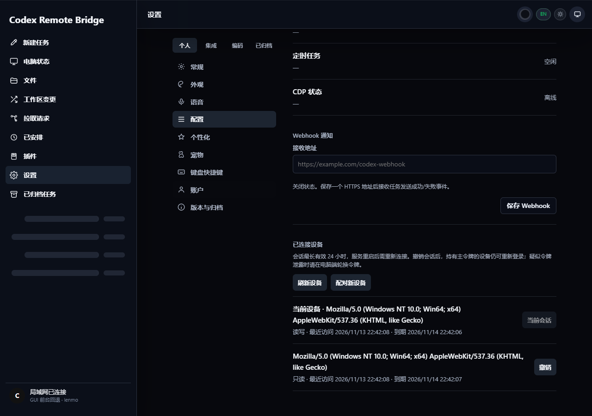
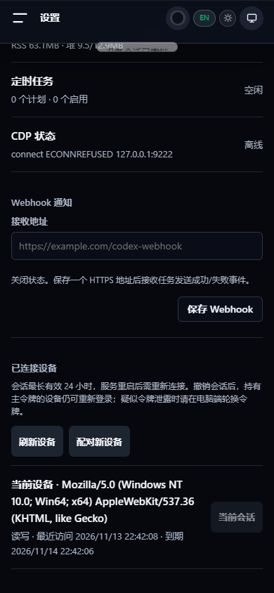
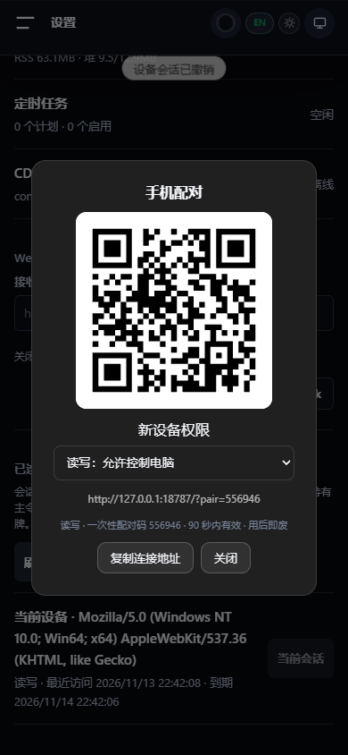

# Codex Remote Bridge 自主升级报告

> 历史阶段记录：下文反映提交、发布前的状态。项目现已决定以 v4.2.0 收尾并永久归档；“后续”与优先级清单不再是维护计划。最终状态见 [归档说明](../ARCHIVE.md) 与 [发布说明](../releases/v4.2.0.md)。

日期：2026-11-13（Asia/Shanghai）。起点：`main` / `8ced514`，工作区干净；版本 `4.1.0`，远程 `yuchen0x1/Codex-Remote-Bridge`。本轮变更留在本地，未提交、推送、改远程、发布或部署。没有修改真实用户会话、令牌或数据库。

## 1. 项目认知与完成范围

产品是手机遥控本机 Codex 的桥接工具。Node.js ≥20 服务无运行时 npm 依赖，使用原生 HTTP/HTTPS、文件状态和 CDP/app-server；Web 是单文件 HTML/JS 加 PWA；Windows 为 .NET 8 WPF，Android 为 Kotlin/Java/Compose，macOS 为 SwiftUI。

| 功能链 | 实际实现 | 本轮覆盖 |
|---|---|---|
| 页面、配对、鉴权、权限 | `public/index.html` → Router → Security/Pairing/SessionManager | 源码、真实 HTTP 与浏览器完整验证新增流程 |
| 聊天、历史、附件 | `server.js`、app-server、平台自动化、session-parser、TailReader | 阅读入口与数据边界，运行已有历史/下载/截图回归；未向真实 Codex 发消息 |
| 调度 | Scheduler → 状态存储 → app-server | 修复有限重试、cron 启用及执行中删除/停用；用故障 fixture 验证 |
| 持久化 | state.json、JSON 队列/日志；可选 better-sqlite3 | 修复目录隔离；验证 JSON 重新打开后读写；没有引入数据库迁移 |
| 实时推送 | `/codex/ws` → CdpWebSocketHub | 实际 TCP 升级测试，Cookie 鉴权、来源校验、撤销、超大帧与清理 |
| 原生客户端/更新 | Windows 安装器校验、Android/macOS Release 检查、TLS 固定 | 检查关键实现并运行可用构建；未做真实安装升级 |
| CI/文档 | GitHub Actions、构建脚本、README、发布文档 | 检查现有门禁，补充本地验证和真实能力说明 |

执行链已完成项目识别、重要代码审计、5 个项目研究、优先级选择、实现、验证和文档同步。审计是有证据的重点路径检查，不代表逐行证明全部代码安全；原生真机、跨版本升级、长时间运行和全部视觉页面仍需后续验收。

## 2. 开源研究与采用依据

通过 GitHub 搜索发现相关方向，并读取下列仓库元数据、目录树、许可证及核心源码。以下维护日期是本次查询时的 `pushed_at`，不代表发布质量；没有复制第三方代码或执行第三方仓库代码。本项目是 MulanPSL-2.0，五个参考项目均核对为 MIT；本次仅独立实现设计思路，没有新增第三方源码的许可证义务。

| 项目 | 实读资料与维护情况 | 借鉴与适配决定 |
|---|---|---|
| [Happy](https://github.com/slopus/happy) | [README](https://github.com/slopus/happy/blob/main/README.md)、[CredentialStore.kt](https://github.com/slopus/happy/blob/main/packages/happy-android/app/src/main/kotlin/com/slopus/happy/auth/CredentialStore.kt)、LICENSE；最后推送 2026-11-13 | 多端接续与独立凭据存储。采用设备会话视角；其加密中继/多模型平台与本地桥接范围不同，未引入云中继 |
| [code-server](https://github.com/coder/code-server) | [login.ts](https://github.com/coder/code-server/blob/main/src/node/routes/login.ts)、[logout.ts](https://github.com/coder/code-server/blob/main/src/node/routes/logout.ts)、目录、LICENSE；2026-11-13 | 查看登录限流、Cookie 和退出处理。修复本项目 Cookie 会话被当作匿名请求的问题；增加服务端撤销 |
| [ttyd](https://github.com/tsl0922/ttyd) | [server.c](https://github.com/tsl0922/ttyd/blob/main/src/server.c)、[protocol.c](https://github.com/tsl0922/ttyd/blob/main/src/protocol.c)、LICENSE；2026-08-12 | 可写权限与 Origin/连接管理。采用明确读写授权、WebSocket 同源与连接限制；不移植终端服务 |
| [GoTTY](https://github.com/yudai/gotty) | [README](https://github.com/yudai/gotty/blob/master/README.md)、[server.go](https://github.com/yudai/gotty/blob/master/server/server.go)、LICENSE；2024-08-01 | 浏览器远程终端的 PermitWrite、WSOrigin 和连接关闭。作为较旧的相邻领域参考，不作为当前依赖选型依据 |
| [Uptime Kuma](https://github.com/louislam/uptime-kuma) | [auth.ts](https://github.com/louislam/uptime-kuma/blob/master/server/auth.ts)、[better-auth.ts](https://github.com/louislam/uptime-kuma/blob/master/server/better-auth.ts)、目录、LICENSE；2026-11-13 | 自托管状态台的 Cookie 会话与重置凭据后撤销会话。采用显式会话状态与撤销生命周期；不引入完整账号系统 |

| 对比维度 | 升级前当前项目 | 参考实践 | 本次落实 |
|---|---|---|---|
| 核心功能 | 有只读 scope，但凭据泄露主 token | ttyd/GoTTY 的明确写权限 | HMAC 独立派生、旧格式拒绝、只读配对 |
| UI | 有配对弹窗，无设备会话管理 | Happy 多设备操作视角 | 权限选择、当前设备、最近访问、到期、刷新/撤销 |
| 用户体验 | 配对请求地址被重复拼接；会话轮询易被限流 | code-server 登录/会话边界 | 修复真实请求路径与 Cookie 配额，不用长期 token 降级伪装成功 |
| 技术架构 | WebSocket 单独只认主 token | ttyd 协议授权与连接控制 | 复用 Security、撤销联动、来源和缓冲限制 |
| 自动化 | 已有重试策略，但计数每轮清零 | 从成熟工具的生命周期管理推导故障边界 | 保留累计次数、停止超限重试、cron 恢复计算；具体修复来自本地源码审计 |
| 扩展能力 | 自定义目录没有覆盖队列/证书；内联 JS 不在检查范围 | 凭据/服务边界分离 | 修复目录契约、稳定会话 ID、新 API、内联脚本门禁 |

## 3. 发现、决策与实现

| 优先级 | 证据/风险 | 实施与收益 | 影响与验证 |
|---|---|---|---|
| P0 | `readOnlyToken()` 返回主 token 加后缀 | HMAC-SHA256 上下文派生、常量时间比较、空凭据拒绝 | 旧只读链接失效；必须轮换曾分享过的主令牌。HTTP/单元通过 |
| P0 | 轮换只改变主 token，旧会话/配对码/实时连接仍可用 | 全部撤销，并提供单会话撤销 | 轮换后需要重连；旧凭据 401、WebSocket 关闭已验证 |
| P1 | Cookie 认证不参与 Router 已认证判定 | 按真实认证结果分类，按会话计额 | 连续 Cookie 请求不再落入匿名低配额；未知 token 不创建独立凭据桶 |
| P1 | 每次重试开始清零 retryCount | 固定 3 次、指数 5 次重试后结束该轮 | 故障注入验证退避增长与预算；不触发真实任务 |
| P1 | catch 引用 try 内 task；停用/删除与异步失败竞态 | 失败后检查任务仍存在且启用 | 不复活被删除任务、不为停用任务安排新重试 |
| P1 | 启用 cron 用 intervalMinutes | 用现有 cron/timezone 计算器 | Asia/Shanghai 时间测试通过 |
| P1 | 配对/锁屏重复调用 apiUrl | 向 fetchApi 传相对 API 路径 | 配对浏览器实测通过；锁屏仅检查调用路径，未实际锁屏 |
| P1 | 自定义状态目录仍把 db/certs 写回默认目录 | 子文件路径派生自实例目录 | 默认路径不变；自定义路径可能生成新 TLS 证书，不擅自迁移旧文件 |
| P2 | 缺设备管理与配对权限选择 | 添加真实列表、读写切换、空/加载/错误状态及撤销 | 复用原界面组件，390px 无横向溢出 |
| P2 | WebSocket 输入缓冲无上限，停止时计时器清理有漏项 | 64 连接/64 KiB 帧、Origin、Cookie、重新鉴权与清理 | 拒绝不支持的分片/二进制；状态通道不需要这些消息类型 |
| P2 | PWA 可能缓存含 token/pair 的 URL | 绕过敏感 URL，升级缓存名，只清理本应用旧缓存 | 单元验证敏感请求不进入缓存 |
| P2 | HTTP npm 脚本使用 POSIX 环境变量语法 | 新增跨平台 Node 启动器 | Windows 浏览器验收通过该命令启动服务 |
| P2 | syntax 检查遗漏主体内联脚本 | vm.Script 解析内联 JS | 无需新增运行时依赖 |

没有删除产品文件，没有新建基础设施，没有改变聊天记录格式。新增 npm 运行时依赖为零。浏览器验证的 Playwright 临时依赖只在忽略目录 `output/evolution/browser`；Gradle 缓存也隔离在项目 `output/evolution/gradle`。

## 4. 重要文件变更

- `src/security/index.js`、`sessions.js`、`pairing.js`：凭据与会话生命周期；`src/routes/index.js`：会话配额分类。
- `server.js`：设备 API、只读配对请求、全局撤销联动、数据路径注入。
- `src/cdp/ws-hub.js`：实时连接认证、协议边界、资源清理。
- `src/scheduler/index.js`：重试计数、失效任务竞态、cron 恢复时间。
- `src/store/queue.js`、`src/security/certs.js`：自定义目录派生规则。
- `public/index.html`、`public/sw.js`：设备面板、配对 UX、请求路径修正与敏感缓存排除。
- `test/scope.test.js`、新增 `test/security-lifecycle.test.js`、`test/scheduler-recovery.test.js`：真实 HTTP/TCP 与故障行为回归。
- `scripts/check-syntax.js`、新增 `scripts/start-http.js`、`package.json`：可移植启动、语法/测试入口。
- README、CHANGELOG、发布说明、新增 `DEVICE_SECURITY.md`、本报告与截图：同步已实现能力和兼容注意事项。

## 5. 验证记录

所有服务测试使用独立数据目录；浏览器未接入真实用户聊天。日志保留在本地 `output/evolution/`。

| 结果 | 检查 | 证据/边界 |
|---|---|---|
| PASS | 修改前 `npm test` | 127/127；这不代表旧权限实现安全，新增行为测试补足缺口 |
| PASS | 最终 `npm test` | 134/134，退出码 0；`final-tests.log` |
| PASS | `npm run check` | 26 个 JS 文件、1 个内联脚本；`syntax-check.log` |
| PASS | `dotnet build windows/CodexMini/CodexMiniWin.csproj -c Release --no-restore` | 零警告、零错误；`windows-build.log`；构建不是安装验收 |
| PASS | `node output/evolution/ui-probe.cjs` | Edge headless，1280×900 与 390×844，真实配对/只读拒写/撤销/权限选择，无 pageerror 或横向溢出；`ui-check.log` |
| PASS | `git diff --check` | 无空白错误；Git 提示原有文件换行归一化不影响退出码 |
| FAIL | Android `testDebugUnitTest lintDebug assembleDebug --no-daemon` | Java/Kotlin 编译完成，Gradle 测试执行器启动失败：`ClassNotFoundException: worker.org.gradle.process.internal.worker.GradleWorkerMain`；不是断言失败。日志 `android-build.log` |
| PASS | Android 直接运行已编译的 JUnit 测试 | `java -cp <JUnit+Hamcrest+testClasses+appClasses> org.junit.runner.JUnitCore com.nhzhongguo.codexmax.ConnectionUrlTest com.nhzhongguo.codexmax.PinnedTlsTest com.nhzhongguo.codexmax.TaskStateTrackerTest`，14 项通过；`android-junit.log`。此结果不等于 Gradle Test 任务通过 |
| PASS | Android 单独 `lintDebug assembleDebug --no-daemon` | 退出码 0，Debug APK 已生成；Lint 0 errors、42 warnings；`android-package.log`。警告包含默认 Locale、目标 API、未用资源和 TLS 信任管理器，未宣称零警告 |
| BLOCKED | macOS 编译/运行 | 当前 Windows 环境无 Xcode/macOS，未执行 |
| PARTIAL | 本机 Codex/CDP/手机端到端 | 未真实发送、审批、锁屏、安装升级；UI fixture 中 CDP 离线显示是预期，不是伪造成功 |
| PARTIAL | PWA | 单元覆盖敏感缓存分支；浏览器 smoke 禁用 Service Worker，未验证实际离线安装生命周期 |

初次浏览器验收发现配对地址重复拼接，修复后重跑通过。内置 Browser 插件因缺失本机运行文件失败；Python Playwright 安装遇到 TLS 下载错误，最终使用项目内 Node Playwright 和系统 Edge 完成验证。上述失败没有被标成产品测试通过。

Android 产物：`android/CodexMax/app/build/outputs/apk/debug/app-debug.apk`（Debug，21,313,495 字节）。仅本地构建，未安装到设备，也不是正式签名发布包。Gradle Test 执行器类加载问题尚未修复；直接 JUnit 的 14 项通过与单独 Lint/APK 构建通过是独立证据。

TLS 警告涉及 `PinnedTls.java` 中的自定义证书固定与首次配对宽松信任流程。源码区分首次获取指纹和后续固定校验，但首次信任仍需要可信网络/人工核对；本轮没有消除或屏蔽这些警告，也没有把 Lint 成功解释成 TLS 安全已充分验证。

截图来自本轮真实运行的隔离实例：

截图中的地址/设备均为测试实例；本机回环地址不能作为真实手机局域网连接入口。

## 6. 后续优先级与限制

| 优先级 | 后续工作 | 本轮不宣称完成的原因 |
|---|---|---|
| P1 | 已分享旧只读链接的部署轮换主令牌 | 需要在实际运行服务执行；本轮只修改项目文件，没有更改用户凭据 |
| P1 | JSON 持久化的故障恢复、原子替换、跨进程锁及调度重启幂等 | 现有队列主要作为执行日志使用，不能直接承诺 exactly-once；需要专门的数据兼容/恢复验收 |
| P1 | 更新清单认证、平台代码签名、真实旧版本升级和回滚 | 当前 SHA-256 只证明与清单一致；没有签名密钥或真实跨版本安装证据 |
| P1 | 真机 TLS 首次信任、断网恢复、Android 后台通知、macOS 运行 | 编译/浏览器视口不能替代实机 |
| P2 | 配对地址的多网卡选择、统一会话过期提示和重新登录入口 | 需覆盖不同 LAN/VPN/反向代理环境；当前提示使用可达 LAN 页面生成二维码 |
| P2 | 拆分大体量 server.js 与内联前端，统一深浅主题和可访问性 | 现有模块化仍不完全；本轮保持局部兼容，未重写所有页面 |
| P2 | 完整 Webhook DNS/重定向私网策略审计 | 当前字符串归一化拦截环回/元数据，但普通 LAN 地址被现有测试明确允许；未宣称完整 SSRF 防护 |
| P3 | 多用户/云中继/插件化控制后端 | 改变产品信任和部署模型，缺少当前用户需求依据，不为对标强加 |

## 7. 完成度评价

采用证据等级而非市场评分：1=占位/缺失，2=实现或局部测试，3=核心本地验证，4=跨平台完整端到端，5=生产长期验证。分数表示本轮能支撑的证据上限。

| 维度 | 等级 /5 | 依据 |
|---|---|---|
| 功能完整度 | 3 | 设备权限流程与主要服务回归通过，真实桌面任务链未验收 |
| UI/UX 成熟度 | 3 | 新流程桌面/手机浏览器已验证，未覆盖全部页面/辅助技术 |
| 代码质量 | 3 | 134 项回归和内联语法门禁；仍有大量单文件业务 |
| 性能 | 2 | 修复误限流与连接资源边界，未做压力/长稳测试 |
| 安全性 | 3 | 具体提权/撤销漏洞有回归证据；未做完整渗透测试，发行签名尚缺 |
| 稳定性 | 3 | 重试、删除竞态、网络与权限失败有行为验证；重启恢复仍不足 |
| 可维护性 | 3 | 复用模块、零新增运行时依赖、补充 API 文档和测试 |
| 扩展性 | 2 | 数据路径与设备接口清晰，但多进程/多用户契约仍未建立 |

本轮交付的是可审查、已本地验证的一组实质改进，不把所有长期路线图或所有平台验收标记为完成。
